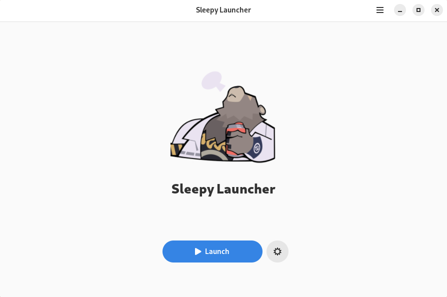
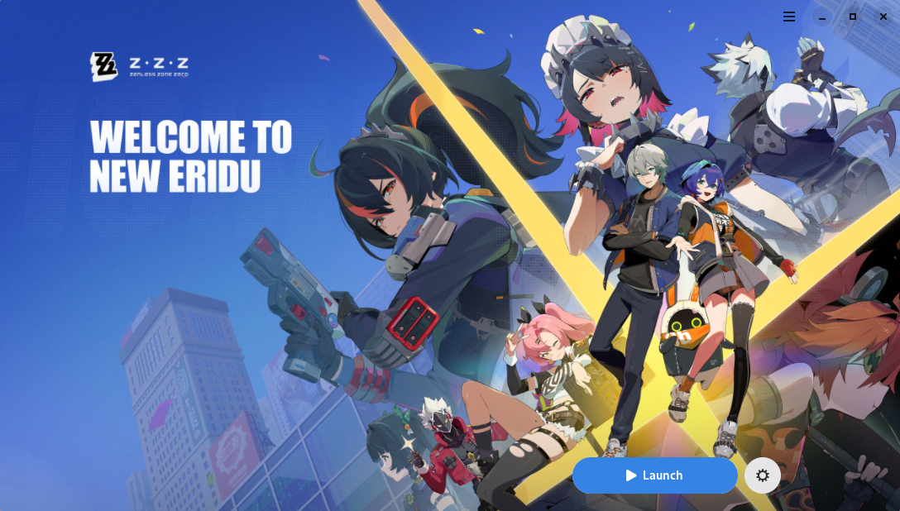
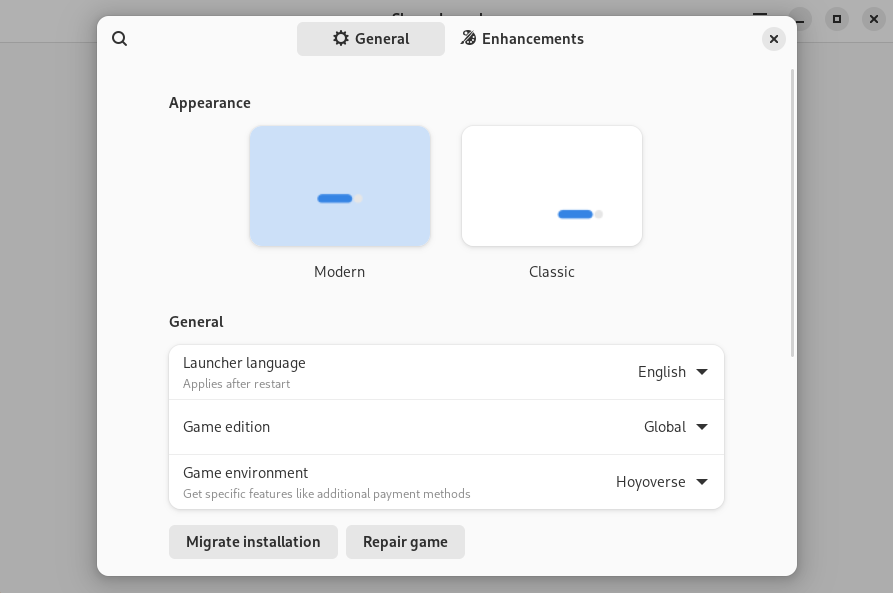
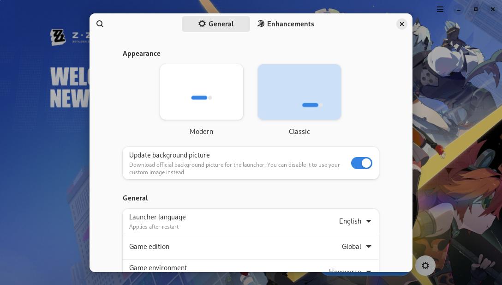

| Modern style | Classic style |
| :-: | :-: |
| <picture><source media="(prefers-color-scheme: dark)" srcset="repository/main-modern-dark.png"></picture> | <picture><source media="(prefers-color-scheme: dark)" srcset="repository/main-classic-dark.png"></picture> |
| <picture><source media="(prefers-color-scheme: dark)" srcset="repository/settings-modern-dark.png"></picture> | <picture><source media="(prefers-color-scheme: dark)" srcset="repository/settings-classic-dark.png"></picture> |

    <a href="https://discord.gg/ck37X6UWBp">Discord</a> ·
    <a href="https://github.com/an-anime-team/sleepy-launcher/wiki">Wiki</a>

 

# 🚧 Project status

This project is considered feature complete for a long time already, and was in
maintenance mode for last years. Many features are outdated or not functional.
Consider switching to another project, for example,
[Anime Games Launcher](https://github.com/an-anime-team/anime-games-launcher).

For more information please join our Discord or Zulip server.

 

# ♥️ Useful links and thanks

* [macOS launcher](https://github.com/3Shain/yet-another-anime-game-launcher) which contains some additional compatibility components
* [Wiki](https://github.com/an-anime-team/sleepy-launcher/wiki) contains some basic FAQ, installation instructions and more
* [Releases page](https://github.com/an-anime-team/sleepy-launcher/releases) where you can find latest available version
* [Changelog](CHANGELOG.md) with chronology of the project

All the project's life happen in our discord server. If you have any questions or want to report an issue - please contact the dev directly there.

 

# ⬇️ Download

Launcher developer does not provide any packages for this programm. Instead, we almost fully rely on other people to maintain them.

To see the installation guides, please visit [this wiki page](https://github.com/an-anime-team/sleepy-launcher/wiki/Installation).

Instructions may be outdated due to lack of interest in maintaining them. You can help the project by keeping documentation up to date if you're interested in it.

## 😀 Official support

These packages are officially supported by the An Anime Team, and we try to ensure that they work for everyone.

| Format | Wiki | Source | Distributions | Maintainer |
| - | - | - | - | - |
| Flatpak | [wiki](https://github.com/an-anime-team/sleepy-launcher/wiki/Installation#-any-distribution-flatpak) | [Flathub](https://flathub.org/apps/moe.launcher.sleepy-launcher) | Any (Fedora, Pop!_OS, SteamOS / Steam Deck, etc.) | NelloKudo |
| RPM | [wiki](https://github.com/an-anime-team/sleepy-launcher/wiki/Installation#-fedora-rpm) | [AAGL](https://build.opensuse.org/repositories/home:Maroxy:AAT-Apps/SL) * | Fedora, OpenSUSE | Maroxy (second discord admin) |

> [!NOTE]
> RPM packages are often really outdated. It's not recommended to use them.

## 🙂 Community support

These packages are supported by active members of our community. They're widely used and we keep some level of interactions with their maintainers.

| Format | Wiki | Source | Distributions | Maintainer |
| - | - | - | - | - |
| AUR | [wiki](https://github.com/an-anime-team/sleepy-launcher/wiki/Installation#-arch-linux-aur) | [sleepy-launcher-bin](https://aur.archlinux.org/packages/sleepy-launcher-bin) | Arch Linux, Manjaro, EndeavourOS | xstra * |
| NixOS module | [wiki](https://github.com/an-anime-team/sleepy-launcher/wiki/Installation#-nixos-nixpkg) | [aagl-gtk-on-nix](https://github.com/ezKEa/aagl-gtk-on-nix) | NixOS | Luxxy * |

> [!NOTE]
> Honorary members of our discord server. We have direct contact with them.

## 😑 Third party support

These packages are supported by third party distributors. They either did not contact us, or contact exceptionally rarely. We do not verify state of these packages, and we are not related to their state at all.

| Format | Source | Distributions |
| - | - | - |
| DEB | [sleepy-launcher](https://launchpad.net/~thundergemios10/+archive/ubuntu/sleepy-launcher) | Ubuntu, Linux Mint, Pop!_OS |
| Pacstall | [sleepy-launcher-bin](https://pacstall.dev/packages/sleepy-launcher-bin) | Ubuntu |
| Ebuild | [aagl-ebuilds](https://github.com/an-anime-team/gentoo-ebuilds) * | Gentoo |
| Lutris | `lutris.net/games/zen...-zero` (stripping the link) | Any |

> [!NOTE]
> Although it's hosted in our official repo we didn't contact with its maintainer for some time already, and recent updates were made via merge requests by the community.

## Chinese version support

This should be automatically enabled if you're using `zh_cn` (Chinese) as your system language. If you're not using it - you can change the game edition in the launcher settings.

The main problem, though, is that github is blocked in China, and it's used in other parts of the launcher - not just in game edition. Notably, you can't use the same components index as other people do.

To fix this, you have to make your own copy of the [components](https://github.com/an-anime-team/components) repository and change all the links there from github releases to some mirror. Later you can update the components index repo link in your launcher's `config.json` file.

If you have any questions - feel free to contact the dev in our discord server (or if you have no way to use discord - try sending me an email, but it's unlikely to be received).
